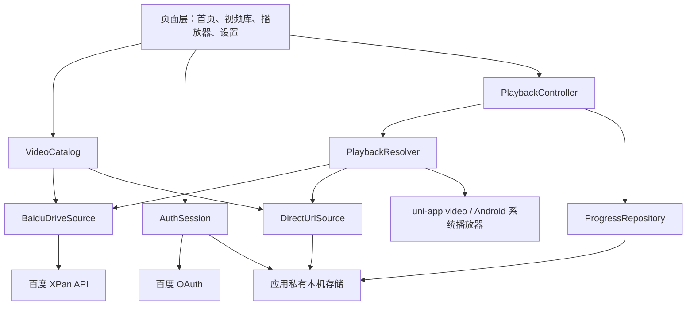

# 片刻视频播放器设计

- 日期：2026-07-18
- 状态：已确认，等待实现计划
- 首发平台：Android App
- 技术栈：uni-app、Vue 3、TypeScript、Vite

## 1. 产品概述

“片刻”是一款专注于网络视频播放与本机续播的 Android App。用户可以通过百度 OAuth 连接个人网盘，浏览并播放百度开放平台应用专属目录中的视频，也可以导入 HTTPS MP4 或 M3U8 媒体直链。App 在本机记录播放进度，下次进入时提供“继续播放”。

第一版不依赖自建后端，不接收百度账号密码，不在 APK 中包含 `SecretKey` 或 `SignKey`。

## 2. 已确认范围

### 2.1 目标

1. 使用百度 OAuth 简化模式连接个人网盘。
2. 递归列出 `/apps/{百度开放平台应用名称}` 下的视频。
3. 将视频路径重建为可浏览的文件夹树，同时提供最近视频列表。
4. 使用官方文件信息与下载地址播放该目录中的原始视频文件。
5. 导入、验证、保存并播放 HTTPS MP4 或 M3U8 媒体直链。
6. 在本机持久化播放进度，提供明确的续播入口。
7. 支持搜索、刷新、删除直链、断开百度授权和清理本机数据。

### 2.2 非目标

1. 不解析百度分享链接或其他视频平台网页地址。
2. 不访问 `/apps/{应用名称}` 以外的百度网盘文件。
3. 不接入百度付费音视频转码服务，不提供百度视频清晰度切换。
4. 不提供离线下载、投屏、跨设备同步、评论或社交功能。
5. 不提供 iOS、H5 或微信小程序正式版本；H5 仅用于带模拟接口的开发验证。
6. 不通过非官方抓取、Cookie 注入或逆向接口绕过百度权限。

## 3. 百度平台边界

### 3.1 OAuth

第一版采用官方简化模式（Implicit Grant）：

- `response_type=token`
- `scope=basic,netdisk`
- App 仅配置 `AppKey` 与回调地址
- 不使用 `SecretKey`
- Access Token 到期后要求用户重新授权，不做自动刷新

授权页面运行在独立的 App WebView 中。App 生成一次性随机 `state`，只接受回调地址、`state` 与预期完全匹配的结果。令牌只写入应用私有本机存储，不写日志，不拼入业务错误文案。

默认回调地址为 `https://localhost/pianke/oauth/baidu`。该地址必须原样登记在百度开放平台；App WebView 在发出网络请求前拦截该跳转并解析 URL fragment。

### 3.2 应用专属目录

2026 年 6 月 3 日后创建的应用，下载、文件信息等关键接口被限制在 `/apps/{appname}`。第一版因此只访问：

```text
/apps/片刻
```

若百度开放平台中的应用名称不是“片刻”，构建配置 `VITE_BAIDU_APP_FOLDER` 必须设置为实际应用名称，界面仍显示“片刻”。所有百度接口调用在发送前都要校验请求路径位于该根目录内。

### 3.3 列表与原文件播放

百度数据源使用以下公开能力：

1. `GET /rest/2.0/xpan/file?method=videolist`，指定专属目录并递归获取视频。
2. `GET /rest/2.0/xpan/multimedia?method=filemetas`，按 `fs_id` 获取时长、缩略图和 `dlink`。
3. 将带有效 Access Token 的下载地址交给 Android 系统播放器，播放原始文件。

本路线不使用百度媒体转码服务。播放是否成功取决于原始文件编码、Android 系统解码能力、账号带宽和下载接口对流式读取的支持。无法播放时必须显示具体错误、文件路径和可执行的返回操作。

### 3.4 试用与上线限制

未通过应用上线审核时：

- 最多 10 个授权用户
- 默认接口频率约 10 次/小时
- 可能返回 `20011`（用户数限制）、`20012`（频率限制）、`20013`（无接口权限）

公开发布前需要准备隐私政策、服务条款、测试说明、OAuth 与核心流程录屏，并提交百度应用上线审核。第一版开发阶段按内部测试应用处理。

### 3.5 凭证处理

此前截图中的凭证视为已暴露，不能用于实现或测试。联调前必须删除并重建应用或轮换凭证。新的 `AppKey` 只放入本机 `.env.local`；新的 `SecretKey` 与 `SignKey` 不进入仓库、聊天、日志或 APK。

## 4. 架构



页面只依赖统一领域接口，不直接拼装百度请求。百度接口、直链、播放状态和本机存储均通过小型、可替换模块隔离。若后续取得百度媒体播放服务或引入 Android 原生播放器，只替换 `PlaybackResolver` 或播放器适配器，不改页面模型。

## 5. 模块职责

### 5.1 页面

| 页面 | 职责 |
| --- | --- |
| 首页 | 展示“接着看”、最近视频、来源连接状态和快捷导入 |
| 视频库 | 在“最近视频”和“按文件夹”之间切换，执行本地搜索与手动刷新 |
| 播放器 | 解析播放地址、显示续播选择、控制播放并保存进度 |
| 设置 | 管理百度授权、直链条目、本机缓存、隐私说明和版本信息 |
| OAuth WebView | 打开授权页、拦截回调、校验 `state`，成功后立即关闭 |

### 5.2 领域服务

| 模块 | 职责 |
| --- | --- |
| `VideoCatalog` | 合并百度与直链来源，排序、搜索并生成首页与文件夹视图 |
| `AuthSession` | 创建授权 URL、校验回调、保存令牌、判断过期和断开连接 |
| `PlaybackResolver` | 按来源解析临时播放地址，不持久化百度 `dlink` |
| `PlaybackController` | 协调加载、续播、倍速、全屏、错误恢复和生命周期事件 |
| `ProgressRepository` | 保存、读取、完成和清理播放进度 |
| `CatalogCache` | 缓存最后一次成功的百度列表，网络失败时提供降级数据 |

### 5.3 数据源适配器

`BaiduDriveSource`：调用 OAuth 与 XPan API，只允许专属目录，负责分页、映射和临时下载地址解析。

`DirectUrlSource`：保存用户输入的 HTTPS 媒体直链和显示名称。它不解析网页，不跟踪网页中的视频资源。

## 6. 数据模型

```ts
type VideoSourceType = 'baidu' | 'direct'

interface VideoItem {
  id: string
  sourceType: VideoSourceType
  sourceId: string
  name: string
  path: string
  sizeBytes?: number
  durationSeconds?: number
  thumbnailUrl?: string
  modifiedAt?: number
}

interface BaiduVideoLocator {
  fsId: string
  path: string
}

interface DirectVideoRecord {
  id: string
  name: string
  url: string
  addedAt: number
}

interface PlaybackProgress {
  videoId: string
  positionSeconds: number
  durationSeconds: number
  updatedAt: number
  completed: boolean
}

interface BaiduAuthSession {
  accessToken: string
  expiresAt: number
  scope: string[]
}
```

百度视频 ID 使用 `baidu:{fsId}`。直链导入时生成并持久化 UUID，视频 ID 使用 `direct:{uuid}`。Access Token 不进入 `VideoItem`、URL 历史或播放进度。

本机存储使用版本化键：

- `pianke:auth:v1`
- `pianke:direct-videos:v1`
- `pianke:progress:v1`
- `pianke:catalog-cache:v1`

## 7. 核心数据流

### 7.1 百度授权

1. 用户点击“连接百度网盘”。
2. `AuthSession` 生成随机 `state` 与官方简化授权 URL。
3. OAuth WebView 打开授权页。
4. WebView 拦截登记的回调地址。
5. App 校验回调地址、`state`、`scope`、`access_token` 和 `expires_in`。
6. 校验通过后保存会话，关闭 WebView，立即同步专属目录。
7. 取消、异常或校验失败时不保存任何数据。

### 7.2 视频同步与文件夹树

1. 若缓存年龄不足 15 分钟，直接使用缓存且不发送网络请求；缓存更旧时先展示缓存，再发起同步。
2. 请求 `/apps/{appname}` 下的递归视频列表，每页最多 1000 条。
3. 将百度响应映射为 `VideoItem`，以 `fs_id` 去重。
4. 根据每条视频的 `path` 在本机重建虚拟文件夹树。
5. 成功后原子替换缓存；失败时继续展示旧缓存并标记“同步失败”。
6. 手动刷新至少间隔 60 秒，连续点击不会重复发送请求。

### 7.3 直链导入

1. 用户输入 URL 和可选显示名称。
2. 仅接受 `https://`。
3. URL 路径扩展名必须为 `.mp4` 或 `.m3u8`，或探测结果返回受支持的媒体 Content-Type。
4. 探测不可用但 URL 形态合法时，允许“尝试添加”，首次播放结果决定状态。
5. 保存 UUID、名称、URL 和添加时间，不复制媒体内容。

### 7.4 播放与续播

1. 点击视频后按来源解析播放地址。
2. 百度视频每次进入播放器时重新获取 `dlink`；不缓存过期地址。
3. 若已有有效进度，显示“继续播放”和“从头播放”。
4. 有效进度定义为：播放超过 30 秒，且距离结尾超过 30 秒。
5. 每 5 秒、暂停、拖动完成、切后台和离开页面时保存进度。
6. 播放达到 95% 或距离结尾不足 30 秒时标记完成，并从“接着看”移除。
7. 完成的视频仍保留在历史记录，可从头重播。

## 8. 页面与视觉设计

### 8.1 导航

底部导航包含：首页、视频库、设置。播放器使用独立页面，不占底部导航。

### 8.2 首页

- 未连接任何来源时，第一屏直接展示“连接百度网盘”和“导入媒体直链”。
- 有有效进度时，顶部展示单个主要续播卡片；没有进度时该区域收起。
- 下方展示最近视频和百度同步状态。

### 8.3 视频库

- 顶部为稳定尺寸的搜索框与添加按钮。
- 分段控件切换“最近视频”和“按文件夹”。
- 搜索只针对已经同步到本机的名称与路径，不额外调用百度搜索接口。
- 文件夹视图来自视频路径，不显示不含视频的空目录。

### 8.4 播放器

- 标准控制：播放/暂停、拖动、当前时间/总时长、全屏、横竖屏、0.5/1/1.25/1.5/2 倍速。
- 百度专属目录视频显示“原始画质”，不显示不可用的清晰度菜单。
- 直链按来源自身提供的画质播放。
- 有效历史进度出现时显示续播选择，不自动跳转。

### 8.5 视觉语言

- 风格：清爽影院。
- 内容背景：中性浅灰或白色。
- 主要文本：近黑色。
- 主操作：绿色。
- 播放进度和强调状态：橙红色。
- 播放区域：深色，确保影片画面是视觉中心。
- 卡片圆角不超过 8px；弹窗与底部面板除外。
- 视频优先使用百度缩略图；失效时使用本地默认封面。
- 页面不使用装饰性渐变、光斑或营销式大标题。

## 9. 异常处理

| 场景 | 行为 |
| --- | --- |
| OAuth 取消 | 返回未连接状态，不显示错误堆栈 |
| OAuth `state` 不匹配 | 拒绝回调，清空本次授权临时状态 |
| Access Token 过期 | 只清除百度会话，保留直链、缓存和进度，提示重新连接 |
| `20011` | 提示未审核应用的测试用户数量已满 |
| `20012` | 显示限流状态与稍后重试，不自动循环请求 |
| `20013` | 提示接口尚未开通或应用需要审核 |
| 网络断开 | 展示缓存列表与离线状态，保留手动重试 |
| 缩略图失效 | 显示本地默认封面 |
| 百度 `dlink` 过期或 403 | 重新解析一次；再次失败后停止自动重试 |
| 原文件编码不支持 | 提示设备无法播放该编码，显示文件路径并允许返回视频库 |
| 直链 404/403/超时 | 标记条目不可用，允许编辑 URL 或删除 |
| 本机存储损坏 | 忽略损坏记录，保留其他可解析数据并显示一次性提示 |

所有错误日志必须清理 Access Token、下载地址查询参数和用户输入 URL 的敏感查询参数。

## 10. 测试与验收

### 10.1 自动化测试

1. 单元测试：OAuth URL 与回调解析、`state` 校验、路径边界、直链校验、视频映射、文件夹树、续播阈值和完成判定。
2. 接口契约测试：模拟百度分页、空目录、过期令牌、限流、无权限、缩略图缺失与 `dlink` 失败。
3. 组件测试：来源空状态、双视图、搜索、直链导入、续播对话框和错误状态。
4. H5 端到端测试：使用模拟百度服务完成授权回调、同步、播放入口、保存进度和再次续播。
5. 安全扫描：确认源码、环境示例、日志快照和构建产物不包含 `SecretKey`、`SignKey` 或真实 Access Token。

### 10.2 Android 实机验收

1. 新安装后可选择百度授权或直链导入。
2. OAuth 成功、取消、过期和异常回调均有正确结果。
3. `/apps/{appname}` 中的视频可同步，目录树与路径一致。
4. 至少验证 H.264/AAC MP4 原文件播放；不支持的编码有清晰错误。
5. HTTPS MP4 与 M3U8 直链可播放。
6. 暂停、拖动、切后台、横屏、全屏和倍速不丢失进度。
7. 杀死 App 后重新进入仍能点击续播。
8. 播放完成后从“接着看”移除，但历史记录仍存在。
9. 断网后保留缓存列表，恢复网络后可手动刷新。

## 11. 实现与发布前置条件

1. 删除并重建此前已暴露凭证的百度应用，应用名称建议使用“片刻”。
2. 在百度控制台登记 `https://localhost/pianke/oauth/baidu` 为授权回调地址。
3. 仅将新 `AppKey` 写入本机 `.env.local`。
4. 在百度网盘中创建或确认 `/apps/片刻`，放入用于实机测试的合法视频。
5. 完成内部测试后，按百度当前要求准备上线审核材料。

## 12. 交付判断

当 Android App 能完成“授权或导入 → 列表与文件夹浏览 → 点击播放 → 保存进度 → 再次打开并续播”，并通过上述自动化测试与实机验收时，第一版目标达成。

## 13. 官方参考

- [创建应用](https://pan.baidu.com/union/doc/%E4%BD%BF%E7%94%A8%E5%85%A5%E9%97%A8/%E5%88%9B%E5%BB%BA%E5%BA%94%E7%94%A8/)
- [简化模式授权](https://pan.baidu.com/union/doc/%E4%BD%BF%E7%94%A8%E5%85%A5%E9%97%A8/%E6%8E%A5%E5%85%A5%E6%8E%88%E6%9D%83/%E7%AE%80%E5%8C%96%E6%A8%A1%E5%BC%8F%E6%8E%A5%E5%85%A5/)
- [获取视频列表](https://pan.baidu.com/union/doc/%E5%9F%BA%E7%A1%80%E7%BD%91%E7%9B%98%E6%9C%8D%E5%8A%A1/%E8%8E%B7%E5%8F%96%E6%96%87%E4%BB%B6%E4%BF%A1%E6%81%AF/%E8%8E%B7%E5%8F%96%E8%A7%86%E9%A2%91%E5%88%97%E8%A1%A8/)
- [查询文件信息](https://pan.baidu.com/union/doc/%E5%9F%BA%E7%A1%80%E7%BD%91%E7%9B%98%E6%9C%8D%E5%8A%A1/%E8%8E%B7%E5%8F%96%E6%96%87%E4%BB%B6%E4%BF%A1%E6%81%AF/%E6%9F%A5%E8%AF%A2%E6%96%87%E4%BB%B6%E4%BF%A1%E6%81%AF/)
- [权限与配额](https://pan.baidu.com/union/doc/%E4%BD%BF%E7%94%A8%E5%85%A5%E9%97%A8/%E6%9D%83%E9%99%90%E4%B8%8E%E9%85%8D%E9%A2%9D/)
- [应用审核指南](https://pan.baidu.com/union/doc/%E4%BD%BF%E7%94%A8%E5%85%A5%E9%97%A8/%E5%BA%94%E7%94%A8%E4%B8%8A%E7%BA%BF%E5%AE%A1%E6%A0%B8/%E5%BA%94%E7%94%A8%E4%B8%8A%E7%BA%BF%E5%AE%A1%E6%A0%B8%E8%AF%95%E8%BF%90%E8%A1%8C/)
- [百度网盘音视频播放服务](https://pan.baidu.com/union/doc/%E5%AA%92%E4%BD%93%E6%9C%8D%E5%8A%A1/%E4%B8%9A%E5%8A%A1%E7%AE%80%E4%BB%8B/)
