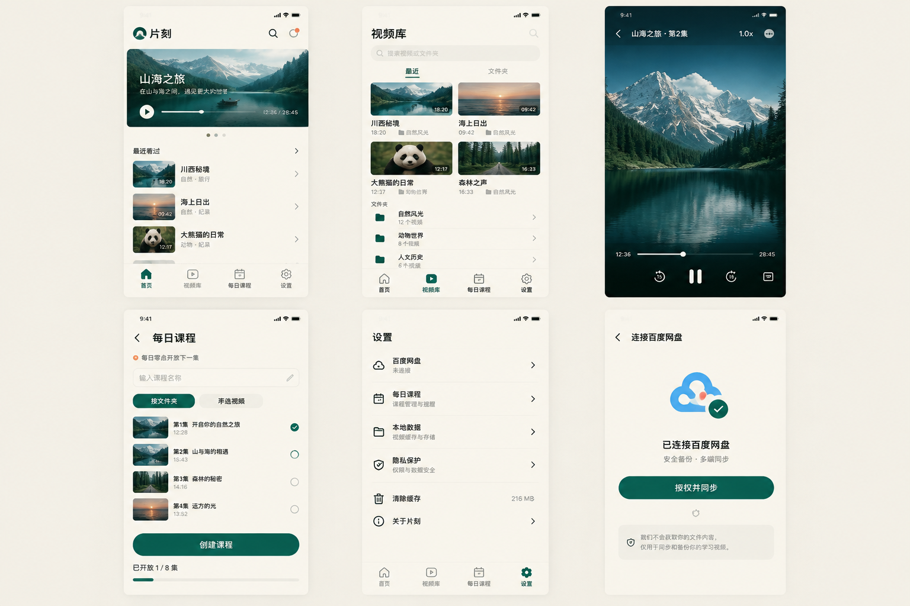

片刻：把收藏的视频编成每日课程，一天解锁一集

存了很多课，却总停在前几集？用片刻自定义每日课程，按文件夹或手动选集，每天解锁一集，还能从上次的位置接着看。

周日晚上，终于想起那套收藏了很久的摄影课。

相机已经擦好了，笔记本也摊在桌上。打开网盘，先找文件夹，再翻视频列表。第3集的标题有点眼熟，第4集好像也点开过。随手播放一段，老师正讲到一半，只好拖着进度条往回找。

折腾几分钟，手机弹来一条消息。回复完，再抬头看看时间，心里又冒出那句熟悉的话：算了，明天再看。

你可能也遇到过这样的晚上。

收藏时很认真，想学也是真的。可一套课程存下来之后，还有不少小事挡在“打开它”和“继续学”之间：文件放在哪儿，上次看到哪儿，今天该看哪一集。

片刻想帮你把这些小事理顺。

先把想看的内容，放到顺手的位置

片刻是一款围绕个人视频观看和学习节奏设计的小工具。

打开首页，“接着看”和“最近看过”放在眼前。有过观看记录的视频，可以从这里重新找到；再次播放时，也可以选择从本机保存的位置继续。

对一节被快递电话打断的课来说，这很实用。回来以后，找到刚才那一节，接着往下看，不必凭印象来回拖进度条。

视频多了，还可以到视频库按文件夹浏览，或者搜索名称。想重温某个知识点时，知道关键词，就有地方找。

片刻也提供百度网盘应用专属目录的连接入口，以及受支持的视频直链添加方式。内容由你自己准备，片刻负责把它们整理成方便打开、方便接着看的视频库。

自定义每日课程，每天解锁一集

最容易让人犹豫的，常常是那一长串待看的集数。

原本只想利用晚饭后的空当学一会儿，看到二三十节课排在一起，又觉得得等一个完整的周末。可周末也有周末的事情。

片刻的“每日课程”，可以由你自己来编。

你可以直接选择一个课程文件夹，也可以从视频库里手动挑出想学的几节，给它起个名字，比如“每天一节摄影课”。一套完整课程，或几段围绕同一个主题的视频，都能按自己的需要安排。

创建当天开放第1集，之后按手机本地日期，每天零点再解锁一集。已经开放的内容随时可以回看；如果忙了几天没打开，开放的集数也会累计，不用重新从第一天等起。

这样，打开课程时，眼前有了一个明确的起点。

比如给自己安排一套摄影入门课。今天看看曝光，明天再学构图。有空就拿起相机试一试，遇到不懂的地方，再回到已经开放的那一集。

课程的安排由自己掌握。想调整节奏，可以关闭每日解锁限制；删除课程，也不会删除原来的视频。

这里的“课程”，是把你已有的视频编成学习安排，片刻本身不提供教学内容。

看一眼它的样子

暖白色的页面，深绿色的按钮，视频封面和标题留在容易看见的位置。首页用来接着看，视频库用来找内容，每日课程用来安排顺序。

下面是片刻的界面设计示意，实际界面与功能以使用版本为准。

让今晚的十几分钟，有个去处

把刚才那个周日晚上换一种过法：

打开片刻，找到那节没看完的摄影课，从保存的位置接着看。听明白一个设置，就拿起相机拍两张。今天先到这里，下次还有地方接上。

一个工具做不了学习本身，但找视频、记进度、安排观看顺序这些琐事，可以少占一点心思。

如果你的网盘里也放着想看的课程，手机里也存着迟迟没点开的视频，可以留意片刻。先挑一套真正想学的内容，从第一节开始，给它留出一点时间。

关于使用：本文以日常学习情境介绍产品思路，并非用户实测记录。观看记录和课程安排保存在本机。片刻目前以 Android 为主要开发方向，百度网盘连接及新版播放器的设备适配仍在完善，具体可用范围以实际版本说明为准。
